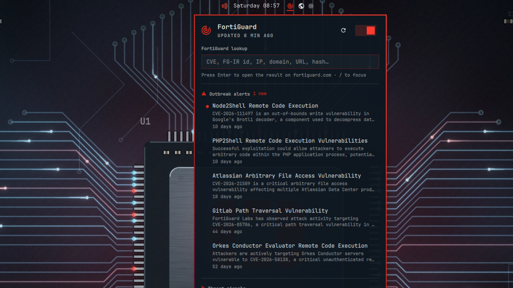

# Bastion — FortiGuard Labs for the Omarchy bar



A radar next to the clock that keeps FortiGuard Labs one click away. It turns
Fortinet red while an Outbreak Alert or a critical PSIRT advisory is unread, and stays
bar-coloured otherwise; hover it for unread counts per feed. The sweep turns while a
refresh runs (not with animations off).

## Install

```
omarchy plugin add https://github.com/charbelsarkis/omarchy-bastion.git --enable
```

Update later with `omarchy plugin update charbel.bastion`.

## Remove

```
omarchy plugin remove charbel.bastion
rm -rf ~/.cache/omarchy-bastion ~/.local/state/omarchy-bastion   # optional: cached feeds and read state
```

## Dependencies

- `python3` (standard library only): the bundled `bastion.py` fetches and sanitizes the feeds.
- Omarchy's own `omarchy-launch-browser` and `omarchy-notification-send`, which ship with Omarchy.
- Network: three fixed HTTPS RSS feeds on fortiguard.com, see [Network](#network). No other
  services; it runs entirely as your user, and nothing outside `~/.cache/omarchy-bastion` and
  `~/.local/state/omarchy-bastion` is written (plus the plugin's own entry in
  `~/.config/omarchy/shell.json` when you change its settings).

## Features

- **Outbreak Alerts** and **Threat Signals**: FortiGuard Labs headlines.
- **PSIRT advisories**: the latest 15 Fortinet product security advisories (enough for
  a monthly batch) with CVSS score, severity and the affected products (FortiOS,
  FortiSIEM, …).
- **FortiGuard lookup**: type a CVE, FG-IR id, IP, domain/URL, file hash or keyword
  and press Enter to open the matching fortiguard.com page in your browser.

The panel lists the latest five Outbreak Alerts, then five Threat Signals, then the
Fortinet-specific PSIRT advisories. Closing it marks what it listed as read. Click a row
to open it. Keys: `/` focuses lookup, `↑/↓` move, `Enter` opens,
`R` refreshes, `Esc` closes. Right- or middle-click the radar to refresh.

## Notifications

When a refresh finds new items, Bastion sends a desktop notification for each one.
Clicking a notification opens that advisory or alert on FortiGuard.

- PSIRT advisories at or above the threshold (default **high**, CVSS 7.0+). Critical
  ones use critical urgency.
- New Outbreak Alerts and Threat Signals.
- At most three individual notifications per refresh, most severe first (critical
  advisory, outbreak alert, high advisory, threat signal, then the rest); the others are
  rolled into one "N more FortiGuard alerts" notification that opens the panel.
- A feed's first successful fetch never notifies, so you don't get the whole backlog at
  once, even if the very first fetch ran offline or with a feed down.
- Notifications are sent one at a time, most severe last, so it sits on top of the stack.

Notifications follow refreshes: hourly in the background, or when you refresh by hand.
To preview them: `omarchy-shell charbel.bastion testNotifications`.

## Network

Fetches only three fixed HTTPS RSS feeds on fortiguard.com, hourly in the background,
in parallel: 15 s timeout per network operation, 45 s for the whole refresh, 2 MiB cap
per feed. Redirects are followed only to HTTPS Fortinet hosts; the host a feed redirects
to (filestore.fortinet.com) is remembered and asked directly next time, falling back to
fortiguard.com if that fails. Requests are conditional (`ETag`/`Last-Modified`), so an
unchanged feed costs a 304 and no download.

If some feeds fail, Bastion keeps showing their last copy and retries every 10 minutes
instead of waiting for the next hourly refresh. Refreshes are scheduled by wall-clock
time, so one that came due while the laptop slept runs within a minute of waking.

Switch background refresh off with the toggle in the panel header; it then refreshes only
when you open the panel (if older than 15 min) or press refresh. Lookups never touch the
network from the shell; they open your browser.

With several monitors every bar has its own copy of the widget. Only one of them
refreshes in the background, and they share read state: reading alerts on one screen
clears them on all.

Settings (`~/.config/omarchy/shell.json`, entry `charbel.bastion`):
`backgroundRefresh` (true), `refreshIntervalMin` (60), `notify` (true),
`notifyPsirt` (`off`/`critical`/`high`/`medium`/`all`, default `high`), `notifyOutbreaks` (true),
`notifyThreatSignals` (true).

Cache: `~/.cache/omarchy-bastion/feeds.json`. Read state: `~/.local/state/omarchy-bastion/state.json`
(plus a `.lock` file beside it).

## IPC

```
omarchy-shell charbel.bastion toggle|open|close|refresh|status|testNotifications
omarchy-shell charbel.bastion lookup CVE-2024-21762     # opens the browser
omarchy-shell charbel.bastion lookupUrl google.com       # prints the URL only
```

## Tests

Run `omarchy restart shell` after edits: `Model.js` stays cached across hot reloads, and
hot reload has been seen to skip `Panel.qml` changes too.


```
python3 -I -m unittest discover -s tests
node tests/model.test.js
```

Not affiliated with or endorsed by Fortinet, Inc. Fortinet, FortiGuard and FortiGate
are trademarks of Fortinet, Inc.; data comes from FortiGuard Labs' public RSS feeds.
